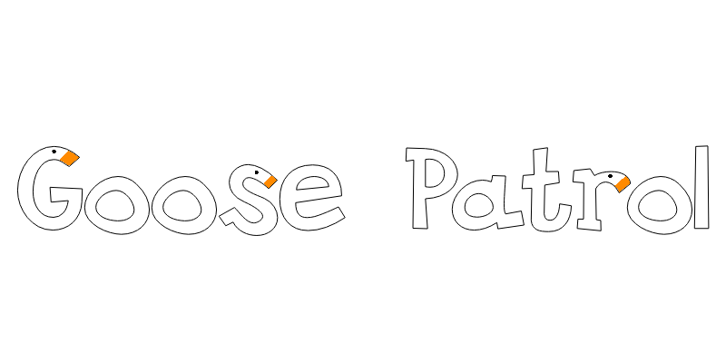

<div align="center">



# Goose Patrol

**A campus evasion game built with libGDX and Java 17.**

Avoid geese, collect items and navigate the campus.

</div>

---

## Quickstart

To run the game on your desktop:

- **Windows:**
  ```powershell
  .\gradlew.bat lwjgl3:run
  ```
- **macOS / Linux:**
  ```bash
  ./gradlew lwjgl3:run
  ```

---

## I want to...

Select a guide below based on what you are working on:

- 🗺️ **[...edit the map, walls, tiles or spawn points](docs/editing_the_map.md)**  
  *How to open `campus.tmx` in Tiled, set up collision rectangles, add new tiles and place spawn markers.*

- 🎒 **[...edit / add sprites](docs/editing_sprites.md)**  
  *How to add a new sprite to the texture atlas and access it via the asset manager.*


