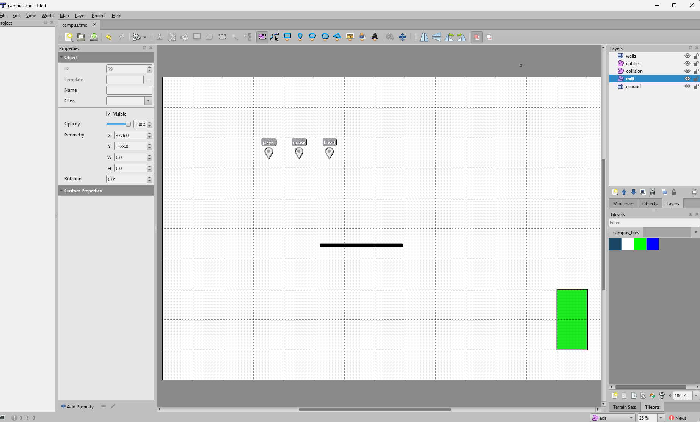
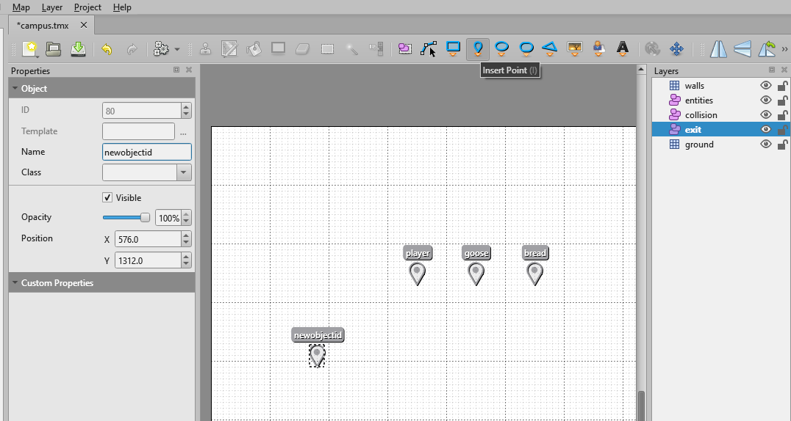

# Editing the Map

This walkthrough shows you how open up the map in Tiled and edit it.

---

## Required Tools

- **Image Editor** : Needed if you want to edit or add new tiles, you can use any but I've been using [Photopea](https://www.photopea.com/) 
- **Map Editor** : We are using [Tiled](https://www.mapeditor.org/) 
- **Tileset Generator**: This is included in the project

## Files

- `assets/tiled/` - The map and tilemap are stored here
- `src/.../goosepatrol/world/MapLoader.java` - The map is parsed by the game here
- `tools/BuildTileset.java` - This is the tool for generating a the tileset.


## Opening the Map in Tiled
Launch Tiled, click 'Open File or Project', navigate to `assets/tiled/campus.tmx` and open it up. You should see something like this:

You can see two types of layers, the purple shape layers known as 'object layers' and the blue grid layers known as 'tile layers'. The game only cares about the object layers, the tile grid layers are purely decorative. For example, if you draw a wall on a tile layer, it won't have any collision, you need to actually draw a rectangle over the wall in the object layer called 'collision' for the game to know about it. 

## Adding Entities
There is an 'object layer' called entites, to add a new entitiy (an item, player, goose ...) add a 'point object' 

The name property is all the game looks for and it determines what entity it spawns there, 'player' and 'goose' are hardcoded. The game will only spawn one player, but you can have as many geese as you'd like. If you want to spawn an item, use the items ID from the item registry. 

## Adding Collision
Draw the wall on a 'tile layer', then go on the 'object layer' called collision and draw a rectangle shape over the wall. You must ONLY USE RECTANGLES - the game does not support any other shapes as the math gets complicated. We could've used a physics engine like Box2D - but getting this all setup and running smoothly is even more complicated - so we didn't.

## Adding / Editing Tiles
All tiles are stored in `raw-assets/tiles` , to edit them open them up in an image editor like Photopea. To add a new one, drop it into this folder. 

It is important to add it onto the end, all files are numbered to preserve their order. If you change the order this will mess up the current map and you will have to redraw it as Tiled relies on the tile position in the map.

After making any changes, run `java tools/BuildTileset.java` from the root of the project, it will output something like this:
```
tile 1: 001_grass.png
tile 2: 002_grass.png
tile 3: 003_grass.png
tile 4: 004_grass.png
tile 5: 005_grass.png
tile 6: 006_grass.png
Wrote assets\tiled\tilemap.png (544x68). In Tiled use margin 2, spacing 4.
```
You should see all the exiting tiles + the ones you have added. The margin and spacing settings are outputted in case you are making the map from scratch. 

Why do we need this tool? You could draw the tilemap yourself but its a bit tedious.

Why add a margin around the tiles? I'm not sure why but LibGDX flickers a ton on certain window sizes, I think it's something to do with OpenGL and non-integer sampling but that's beyond me and this is a simple enough fix.

## Special Layers
Currently the only other layer is called exit, the game looks for a rectangle on this layer and checks if the player enters it, if they do (and aren't being chased by any geese) the game ends.

## Map Parsing
When a GameScreen is created it initialises a bunch of stuff, one thing being the GameWorld, the world contains all the data for the game. It is the 'simulation' , it doesn't handle any rendering. 
So GameScreen creates a GameWorld, and GameWorld creates a map, it does this using the MapLoader class, which as you may have guessed loads the map. 

Look in MapLoaders contructor:
``` Java
MapLayer collisionLayer = map.getLayers().get("collision");
        if (collisionLayer != null) {
            for (var obj : collisionLayer.getObjects().getByType(RectangleMapObject.class)) {
                walls.add(obj.getRectangle());
            }
        }
```
It gets the collision layer, loops through all the rectangle objects and adds them to an array of rectangles called 'walls'. Pretty simple right? The rest of the layers work similairly, get the layer, loop through everything in it and store it. 
``` Java
 public Array<Rectangle> getWalls() {
        return walls;
    }
```
The walls are exposed through a public getter, the game world uses this for collisions. It can be used anywhere else that has a reference to the map too, such as pathfinding. 